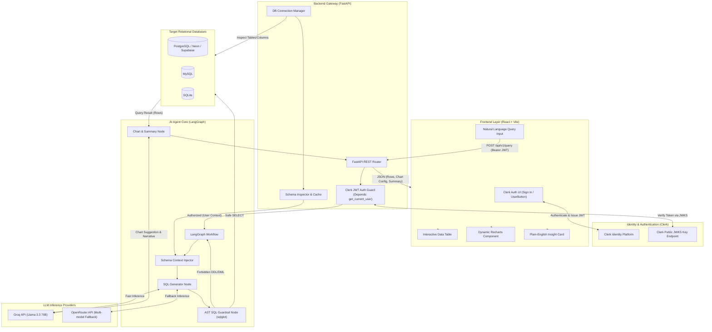
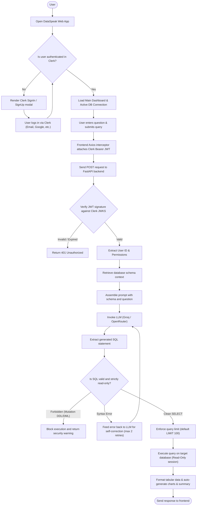
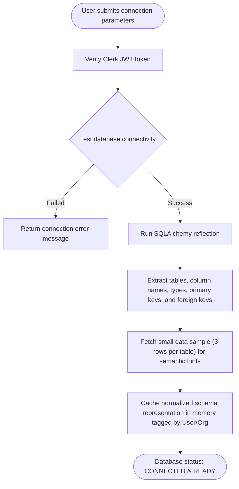

# Architecture Document

## System Overview
DataSpeak is an AI-powered Text-to-SQL platform designed for non-technical users. It converts natural language queries into safe, read-only SQL queries against relational databases (PostgreSQL including Neon & Supabase, MySQL, SQLite), executes them, and returns structured data tables, auto-generated visual charts, and plain-English narrative summaries. 

User identity, session management, and API access are secured using **Clerk**.

---

## 1. Tech Stack

### Authentication & User Management
- **Auth Provider:** Clerk
- **Frontend Integration:** `@clerk/clerk-react` (Pre-built `<SignIn />`, `<SignUp />`, `<UserButton />`, and `useAuth` token hook)
- **Backend Verification:** FastAPI dependency with Clerk JWKS verification (`PyJWT` / `cryptography`) enforcing Bearer JWT token validation on protected endpoints

### Frontend
- **Framework:** React 18 + Vite (TypeScript)
- **Authentication:** `@clerk/clerk-react`
- **Styling:** Tailwind CSS
- **Component & UI Icons:** Lucide React
- **Data Visualization:** Recharts (Dynamic Bar, Line, Area, and Pie charts)
- **Data Tables:** TanStack Table (React Table v8) for sorting and pagination
- **HTTP Client & State:** Axios (with Clerk Authorization Bearer interceptor) + TanStack Query (React Query)

### Backend
- **Framework:** Python 3.11+ with FastAPI & Uvicorn (Asynchronous REST API)
- **Authentication:** Clerk JWT Bearer Authentication (`fastapi.security.HTTPBearer`)
- **Agent Orchestration:** LangChain & LangGraph (Stateful graph for query generation, validation, and self-correction)
- **LLM Inference:** Groq API (`ChatGroq`) or OpenRouter API (`ChatOpenAI`)
  - Primary Models: `llama-3.3-70b-versatile` (Groq) or `qwen-2.5-coder-32b` / `deepseek-chat` (OpenRouter)
- **Database Access & ORM:** SQLAlchemy 2.0 (Async engine)
  - Connectors: `asyncpg` (PostgreSQL, Neon, Supabase with SSL/TLS and connection pooling support), `aiomysql` (MySQL), `aiosqlite` (SQLite)
  - Cloud PostgreSQL Compatibility: Native support for Neon (`sslmode=require`, pooled endpoints) and Supabase (Transaction/Session pooler on port 6543 / 5432)
- **SQL Security & AST Parsing:** `sqlglot` (Strict read-only AST parser, statement type validation, automatic `LIMIT` enforcement)
- **Data Serialization:** Pydantic v2

---

## 2. Architecture Diagram



---

## 3. Flow Charts

### User Authentication & Protected Query Flow



### Database Connection & Schema Ingestion Flow



---

## 4. Folder Structure

```
text-to-sql/
├── backend/
│   ├── app/
│   │   ├── api/
│   │   │   ├── v1/
│   │   │   │   ├── connections.py      # Connect, test, and disconnect database
│   │   │   │   ├── queries.py          # Process natural language queries
│   │   │   │   ├── schema.py           # Get active schema and table details
│   │   │   │   └── history.py          # Query history and bookmarks
│   │   │   └── api_router.py
│   │   ├── core/
│   │   │   ├── config.py               # App configuration & environment settings
│   │   │   ├── auth.py                 # Clerk JWT verification & get_current_user dependency
│   │   │   └── security.py             # Read-only policy & sanitization helpers
│   │   ├── agent/
│   │   │   ├── state.py                # LangGraph agent state definition
│   │   │   ├── graph.py                # Graph compilation (nodes and conditional edges)
│   │   │   ├── prompts.py              # System prompts for SQL generation & summarization
│   │   │   └── llm.py                  # Groq and OpenRouter client providers
│   │   ├── guardrails/
│   │   │   ├── validator.py            # sqlglot-based read-only AST validator
│   │   │   └── sanitizer.py            # SQL cleanup and LIMIT enforcement
│   │   ├── db/
│   │   │   ├── connection.py           # Dynamic SQLAlchemy async engine factory
│   │   │   ├── inspector.py            # Schema reflection & metadata extractor
│   │   │   └── executor.py             # Safe query execution handler
│   │   ├── models/
│   │   │   ├── user.py                 # Clerk authenticated user representation
│   │   │   ├── request.py              # Pydantic request models
│   │   │   └── response.py             # Pydantic response models (Table, Chart, Summary)
│   │   └── services/
│   │       ├── chart_service.py        # Chart type selector (bar, line, pie)
│   │       └── summary_service.py      # Plain-English insight generator
│   ├── tests/
│   │   ├── test_auth.py                # Unit tests for Clerk JWT verification
│   │   ├── test_guardrails.py          # Unit tests for query blocking
│   │   ├── test_agent.py               # Unit tests for text-to-SQL logic
│   │   └── test_api.py                 # Endpoint integration tests
│   ├── requirements.txt                # Python dependencies (includes pyjwt, cryptography)
│   ├── .env.example                    # Environment variable template (CLERK_ISSUER, etc.)
│   └── main.py                         # Application entrypoint
│
├── frontend/
│   ├── public/
│   │   └── favicon.svg
│   ├── src/
│   │   ├── components/
│   │   │   ├── auth/
│   │   │   │   ├── ProtectedRoute.tsx  # Clerk auth protection gate
│   │   │   │   └── AuthNavbar.tsx      # Clerk UserButton & organization switcher
│   │   │   ├── chat/
│   │   │   │   ├── QueryInput.tsx      # Natural language search box
│   │   │   │   ├── QueryHistory.tsx    # Recent questions & saved queries
│   │   │   │   └── SqlPreviewModal.tsx # Transparent SQL preview modal
│   │   │   ├── results/
│   │   │   │   ├── DataTable.tsx       # Interactive paginated results table
│   │   │   │   ├── ChartViewer.tsx     # Dynamic Recharts renderer (Bar, Line, Pie)
│   │   │   │   ├── InsightCard.tsx     # AI plain-English summary card
│   │   │   │   └── ExportButton.tsx    # CSV/Excel export trigger
│   │   │   ├── schema/
│   │   │   │   └── SchemaExplorer.tsx  # Sidebar listing available tables & columns
│   │   │   ├── settings/
│   │   │   │   └── DbConnectionModal.tsx # Connection configuration modal
│   │   │   └── layout/
│   │   │       ├── Header.tsx
│   │   │       ├── Sidebar.tsx
│   │   │       └── AppLayout.tsx
│   │   ├── hooks/
│   │   │   ├── useQueryExecution.ts    # React Query hook for running queries
│   │   │   └── useDatabase.ts          # Hook for managing connection state
│   │   ├── services/
│   │   │   └── api.ts                  # Axios client with Clerk Bearer token interceptor
│   │   ├── types/
│   │   │   └── index.ts                # TypeScript interfaces (QueryResponse, Schema, User)
│   │   ├── utils/
│   │   │   └── exportUtils.ts          # CSV generation and download helper
│   │   ├── App.tsx                     # ClerkProvider wrapper & main layout
│   │   ├── index.css                   # Tailwind CSS imports and design tokens
│   │   └── main.tsx                    # React DOM entry point
│   ├── package.json                    # Dependencies (includes @clerk/clerk-react)
│   ├── tsconfig.json
│   ├── tailwind.config.js
│   └── vite.config.ts
│
├── PRD.md                              # Product Requirements Document
├── ARCHITECTURE.md                     # System Architecture & Technical Specifications
└── README.md                           # Project setup and getting started guide
```
